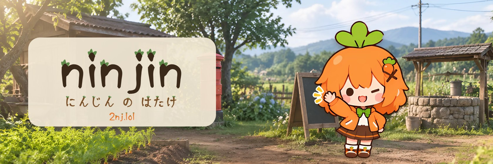
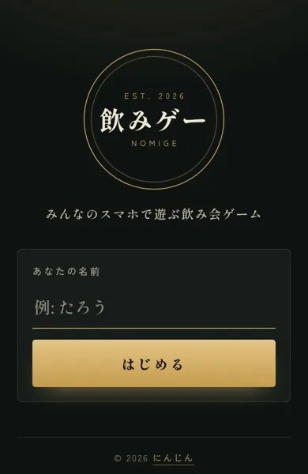
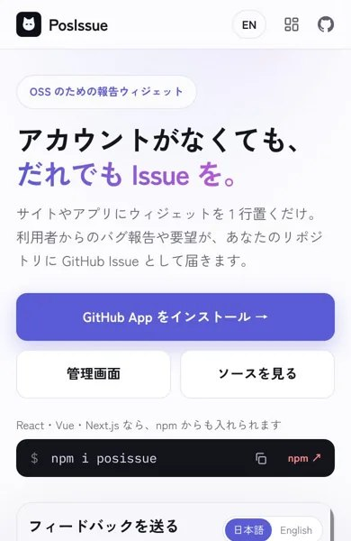
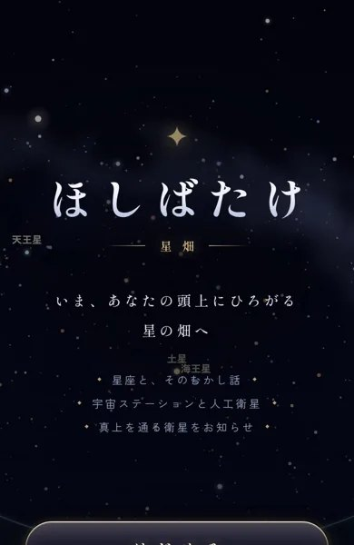
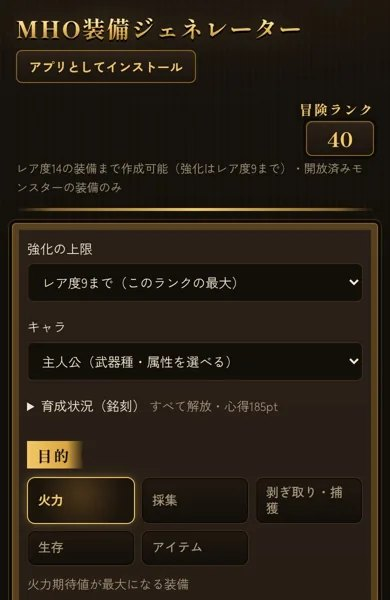
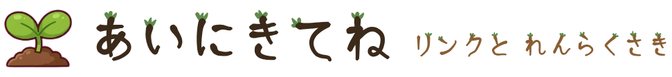

<a href="https://2nj.lol/"><picture><source media="(prefers-color-scheme: dark)" srcset="assets/banner-dark.jpg"></picture></a>

  個人開発者です。 
  Web アプリ、Android アプリ、プログラミング言語まで、 
  気になったものは作って確かめています。 
  An indie developer in Japan. From web and Android apps to a programming language, I build things to find out how they work.

<h2><picture><source media="(prefers-color-scheme: dark)" srcset="assets/head-grown-dark.png"></picture></h2>

<table>
  <tr>
    <td width="25%" align="center" valign="top">
       
      <b><a href="https://nomige.2nj.lol">飲みゲー</a></b> 
      みんなのスマホで遊ぶ飲み会ゲーム。4桁のルームコードですぐ集合でき、インストールはいりません。
    </td>
    <td width="25%" align="center" valign="top">
       
      <b><a href="https://posissue.2nj.lol">posissue</a></b> 
      サイトに1行置くだけで、利用者のバグ報告や要望が GitHub Issue として届くウィジェット。 <a href="https://github.com/ninjin0802/posissue">GitHub</a>
    </td>
    <td width="25%" align="center" valign="top">
       
      <b><a href="https://sky.2nj.lol">ほしばたけ</a></b> 
      いま頭上にひろがる星空を見るアプリ。星座と惑星、そのむかし話、宇宙ステーションの通り道も。
    </td>
    <td width="25%" align="center" valign="top">
       
      <b><a href="https://mho.2nj.lol">MHO装備ジェネレーター</a></b> 
      モンハンアウトランダーズの装備を、ランク・武器・属性から自動で組み立てます。
    </td>
  </tr>
</table>

<h2><picture><source media="(prefers-color-scheme: dark)" srcset="assets/head-seeds-dark.png"></picture></h2>

| なまえ | どんなもの | ことば |
|---|---|---|
| [kata-lang](https://github.com/ninjin0802/kata-lang) | AI エージェントが書いて読むことを考えた、Android 向けの実験的な言語 | Java |
| [spotfy](https://github.com/ninjin0802/spotfy) | Spotify Web Player を公式アプリのように使える、非公式の Android アプリ | Kotlin |
| [にんふぉんと](https://github.com/ninjin0802/font) | にんじんの形をした手書きのフォント。見出しもこの字です | Python |
| [game-mode](https://github.com/ninjin0802/game-mode) | Pixel 向けの、ワンタップで切り替えるゲームモード | Java |
| [SnapPurge](https://github.com/ninjin0802/SnapPurge) | スクリーンショットを、端末の中だけで整理する Android アプリ | Kotlin |
| [twedel](https://github.com/ninjin0802/twedel) | 自分の X のポストやいいねを、まとめて整理する Windows アプリ | TypeScript |

<h2><picture><source media="(prefers-color-scheme: dark)" srcset="assets/head-field-dark.png"></picture></h2>

<picture><source media="(prefers-color-scheme: dark)" srcset="https://raw.githubusercontent.com/ninjin0802/ninjin0802/field/field-dark.svg"></picture>

コントリビューションの多い日ほど、大きく育ちます。毎朝 GitHub Actions が描き直しています（<a href="scripts/field.mjs">描いているスクリプト</a>）。

<h2><picture><source media="(prefers-color-scheme: dark)" srcset="assets/head-contact-dark.png"></picture></h2>

[ホームページ 2nj.lol](https://2nj.lol/)　[ブログ](https://blog.2nj.lol)　[X @_nin82](https://x.com/_nin82)　[Discord](https://discord.com/users/143591147388928000)　[info@2nj.lol](mailto:info@2nj.lol)

役に立ったら、にんじんにお水をください。[OFUSE で応援する](https://ofuse.me/ninjin)　[LINE スタンプ「それゆけにんじん」](https://line.me/S/sticker/37472175)
