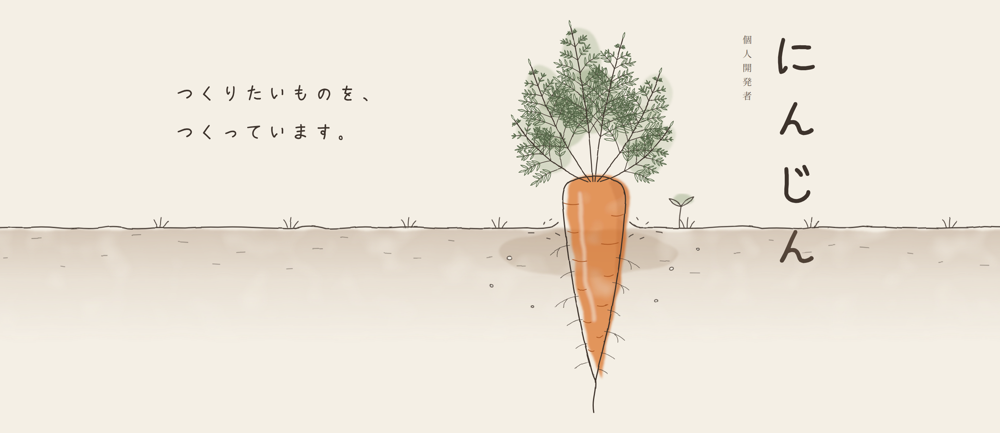
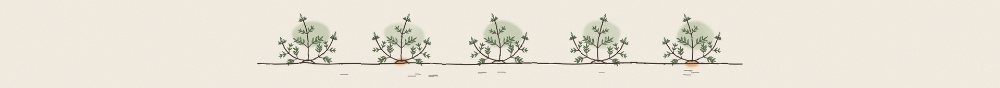

  
  
  
  
  

<h3 align="center">🥕 つくりたいものを、つくって確かめる。</h3>

  りんくるを運営している個人開発者です。 
  Web アプリ、Android / Windows アプリ、フォント、プログラミング言語まで。 
  気になったものは、自分の手で作って確かめています。 
  <i>Indie developer in Japan — I build things to find out how they work.</i>

 

## 🌱 Works

<table>
  <tr>
    <td width="50%" valign="top">
      <h4>🔗 <a href="https://rit.2nj.lol">りんくる</a></h4>
      運営中のサービス  
      個人で運営している Web サービス。  
      
      
    </td>
    <td width="50%" valign="top">
      <h4>🧪 <a href="https://github.com/ninjin0802/kata-lang">kata-lang</a></h4>
      実験的なプログラミング言語  
      AI コーディングエージェントが書きやすく・読みやすいことを目指した、Android 向けの言語。  
      
      
    </td>
  </tr>
  <tr>
    <td width="50%" valign="top">
      <h4>🧹 <a href="https://github.com/ninjin0802/twedel">twedel</a></h4>
      Windows アプリ  
      自分の X のポスト・返信・リポスト・いいねを、安全にまとめて整理するアプリ。  
      
      
    </td>
    <td width="50%" valign="top">
      <h4>📸 <a href="https://github.com/ninjin0802/SnapPurge">SnapPurge</a></h4>
      Android アプリ  
      スクリーンショットを、端末内だけで見つけやすく整理するアプリ。  
      
      
    </td>
  </tr>
  <tr>
    <td width="50%" valign="top">
      <h4>✍️ <a href="https://github.com/ninjin0802/font">にんふぉんと</a></h4>
      フォント  
      にんじんの形をした手書きのフォント。  
      
      
    </td>
    <td width="50%" valign="top">
      <h4>🎧 <a href="https://github.com/ninjin0802/spotfy">spotfy</a></h4>
      Android アプリ  
      Spotify Web Player を包む、個人用の Android アプリ。  
      
      
    </td>
  </tr>
</table>

 

## 🧰 Tools

  

 

おしまい。 © にんじん

